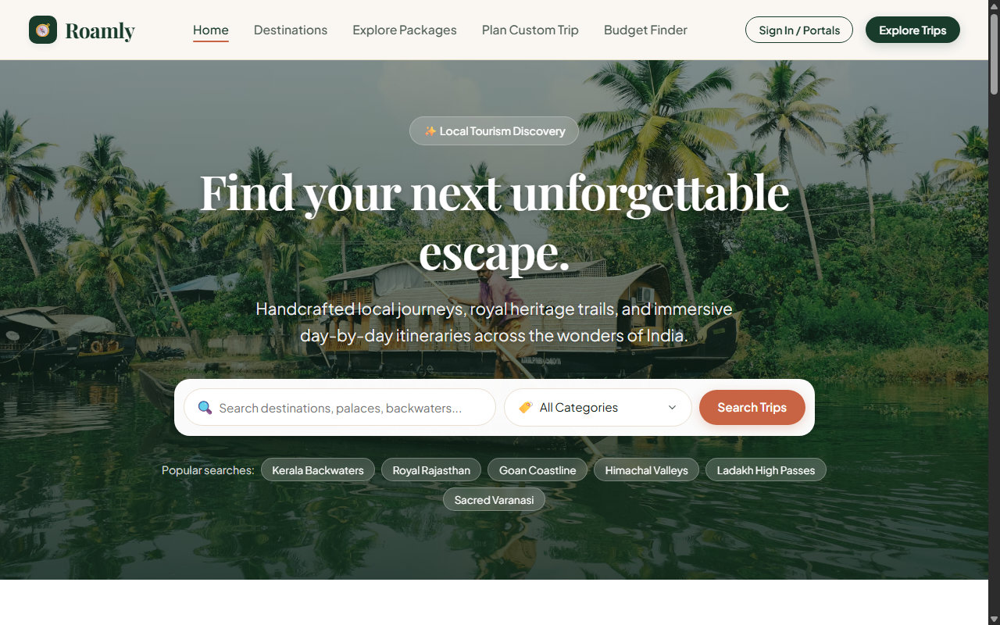
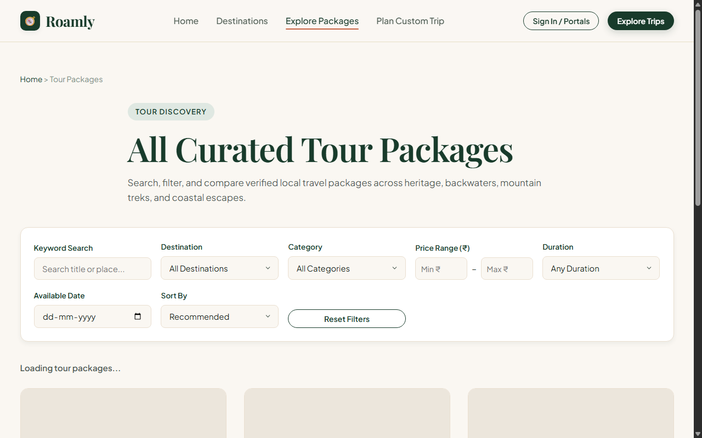
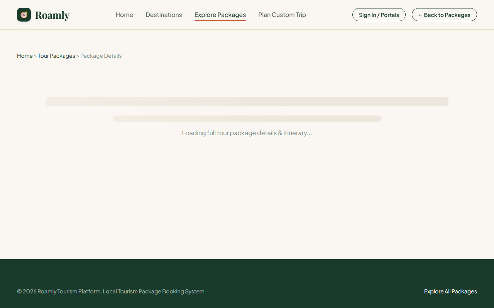
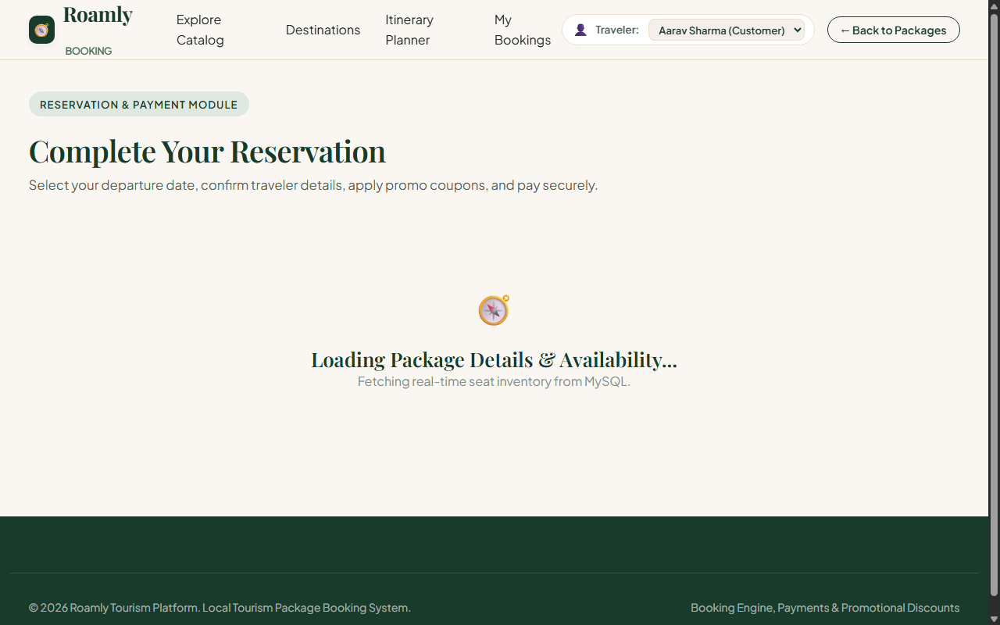
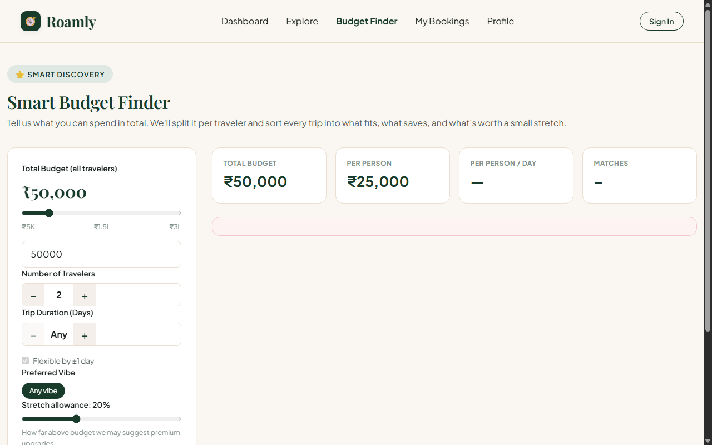
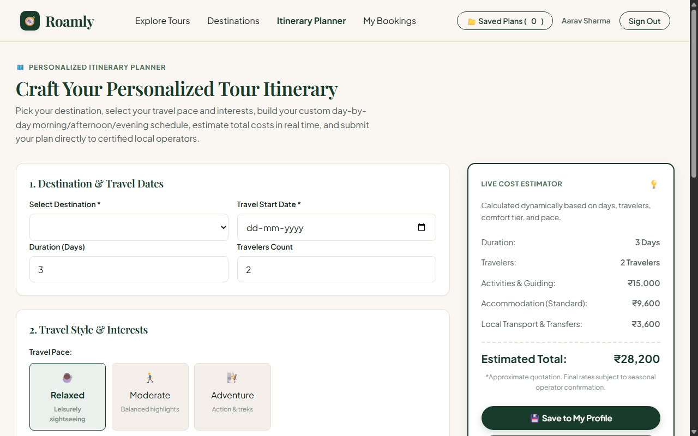
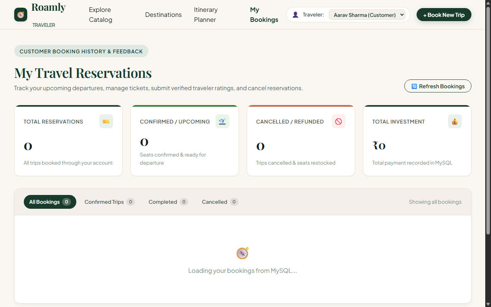
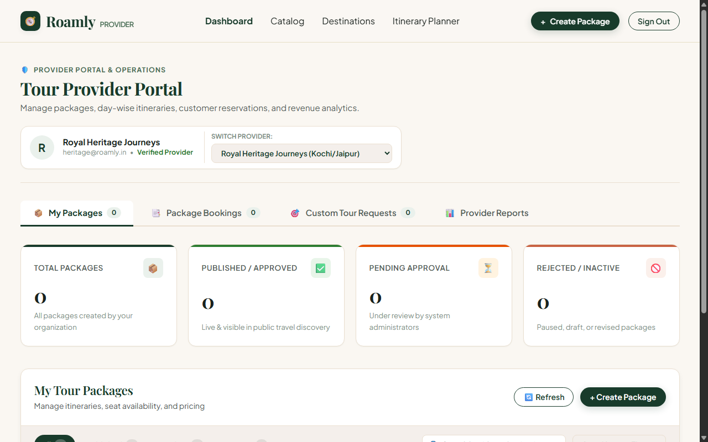
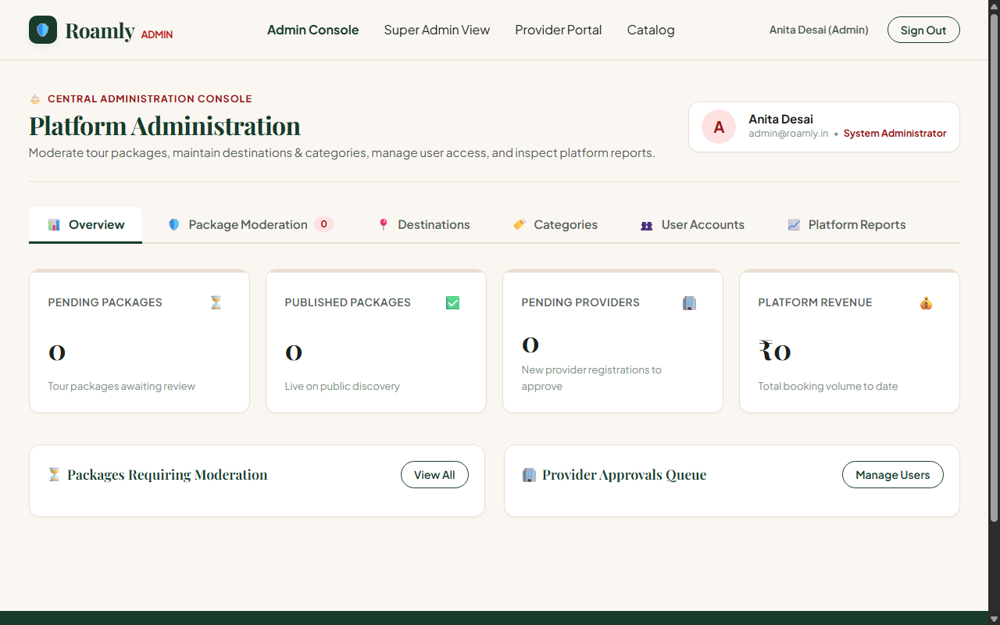
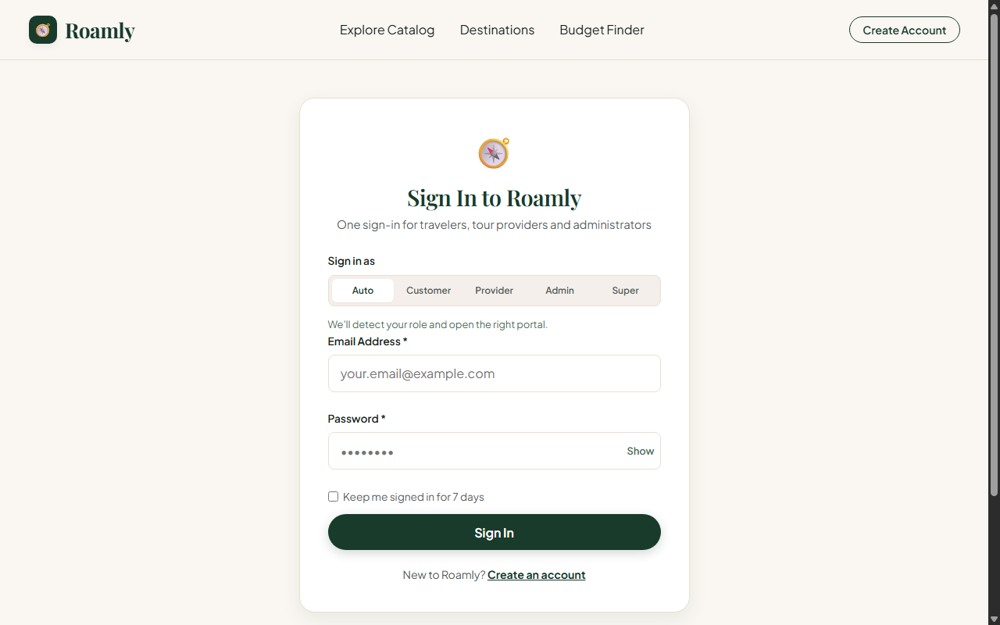

# 🧭 Roamly: Local Tourism Package Booking System

[](https://web-production-22049391.up.railway.app)
[-339933?style=for-the-badge&logo=nodedotjs)](https://nodejs.org)
[](https://www.mysql.com)
[](https://developer.mozilla.org)

A production-grade, full-stack tourism platform designed for discovering, planning, and booking curated regional tour packages across India. Built strictly **without third-party frameworks** — utilizing pure built-in Node.js modules (`http`, `url`, `crypto`, `fs`, `path`), native Vanilla JavaScript DOM manipulation & Fetch API, and a normalized MySQL 8 relational schema with foreign key constraints and ACID-compliant transactions.

---

## 🌐 Live Hosted Application

### 🔗 **[https://web-production-22049391.up.railway.app](https://web-production-22049391.up.railway.app)**

> **Hosted Infrastructure**: Deployed on Railway Cloud with an automated Node.js container service, a managed MySQL 8 database service with volume persistence, automatic database bootstrapping, and end-to-end SSL encryption.

---

## 📸 Application Showcase & Screenshots

### 1. Home Discovery & Regional Spotlight
Explore curated tour packages, royal heritage circuits, tranquil backwaters, and Himalayan escapes with live category counts and starting prices.


---

### 2. Interactive Package Catalog & Multi-Criteria Filtering
Filter packages dynamically by search query, destination, travel style, budget range, duration presets, and departure dates without full page reloads.


---

### 3. Package Details, Day-by-Day Itineraries & Verified Reviews
Transparent itinerary timeline highlighting morning, afternoon, and evening excursions, operator credentials, live departure seat calendar, and customer star reviews.


---

### 4. Step-by-Step Reservation & Checkout Engine
Select confirmed departure dates, adjust traveler counts with real-time seat decrement validation, apply promotional coupons, and choose from simulated payment gateways.


---

### 5. Smart Budget-Based Package Finder
A financial optimization tool: input total budget, group size, and preferred travel pace to view categorized matches (*Direct Fits*, *Budget Savers* with leftover pocket allowance, and *Stretch Matches*).


---

### 6. Personalized Day-by-Day Itinerary Planner
Interactive trip designer: customize destinations, travel style, accommodation comfort tiers, and daily activities with live dynamic cost estimates and direct submission to local tour providers.


---

### 7. Customer Dashboard, Booking History & Cancellations
Track past, upcoming, and cancelled journeys with summary metric banners, booking vouchers, one-click cancellations with automatic seat restock, and 5-star review submissions.


---

### 8. Tour Provider Operations Portal
Dedicated portal for registered tour operators to publish tours, manage day-by-day itineraries, schedule departure dates, monitor reservations, review custom travel inquiries, and track monthly earnings.


---

### 9. Central Administrator & Super Admin Governance Console
Centralized platform administration: moderate submitted packages with feedback notes, manage destinations and categories (CRUD), activate/suspend user accounts, inspect the system audit trail, and delegate admin permissions.


---

### 10. Unified Multi-Role Authentication
Single sign-in screen featuring automatic role detection for Customers, Tour Providers, Administrators, and Super Administrators with HMAC-signed session cookies and "Remember Me" persistence.


---

## 🔑 Demo Test Credentials

All demo accounts share the password: **`demoPassword123`**

| Role | Email | Password | Direct Portal Link |
|---|---|---|---|
| **Customer** | `aarav@customer.in` | `demoPassword123` | [/customer/customer-dashboard.html](https://web-production-22049391.up.railway.app/customer/customer-dashboard.html) |
| **Customer (Alt)** | `priya@customer.in` | `demoPassword123` | [/customer/customer-dashboard.html](https://web-production-22049391.up.railway.app/customer/customer-dashboard.html) |
| **Tour Provider** | `heritage@roamly.in` | `demoPassword123` | [/provider/dashboard.html](https://web-production-22049391.up.railway.app/provider/dashboard.html) |
| **Administrator** | `admin@roamly.in` | `demoPassword123` | [/admin/dashboard.html](https://web-production-22049391.up.railway.app/admin/dashboard.html) |
| **Super Admin** | `superadmin@roamly.in` | `demoPassword123` | [/superadmin/dashboard.html](https://web-production-22049391.up.railway.app/superadmin/dashboard.html) |

---

## 🌟 Comprehensive Features Breakdown

### 🎯 Public Discovery & Catalog
- **Hero Search Engine**: Live keyword lookup across tour titles, cities, and landmarks with category filters and quick search tags.
- **Dynamic Catalog Filters**: Filter by destination, category, price range slider, duration checkboxes (1-3 days, 4-7 days, 8+ days), departure calendar, and sort options (Recommended, Price Low-to-High, Price High-to-Low, Duration).
- **Package Details Drawer & Standalone View**: Complete trip breakdown including operator credentials, day-by-day vertical timeline itineraries, and guaranteed departure dates.

### 💳 Reservation & Booking Engine
- **Atomic Booking Lifecycle**: Validates seat availability, executes atomic seat decrements in `package_availability`, and writes to `bookings`, `payments`, and `system_logs` in a single transaction.
- **Payment Simulation Gateway**: Supports 4 payment options (UPI Virtual Payment Address, Credit/Debit Cards, Net Banking, and Pay on Arrival).
- **Printable Booking Voucher**: Generates booking reference code (`ROAM-XXXXXX`), customer receipt modal, and printable confirmation.

### 🏷️ Promotional Coupon & Discount System
- **Real-Time AJAX Validation**: Validates coupon codes against expiration dates, usage limits, and minimum booking thresholds before checkout.
- **Active Demo Coupons**:
  - `EXPLORE10`: 10% off (Min booking: ₹500)
  - `FESTIVE25`: 25% off (Min booking: ₹1,000, Max discount: ₹5,000)
  - `ROAMLY1000`: Flat ₹1,000 instant discount (Min booking: ₹5,000)
  - `EARLYBIRD`: 15% off (Min booking: ₹2,000)

### 📋 Customer Profile, Trips & Reviews
- **Booking Management**: Filter trips by *All*, *Upcoming*, *Completed*, and *Cancelled*.
- **Self-Service Cancellation**: Automatically restocks seats to `package_availability`, updates status to `CANCELLED`, and logs refund confirmation.
- **Verified Reviews**: 5-star rating system with written feedback gated strictly to verified, non-cancelled customer bookings.
- **Profile & Address Book**: Manage contact details, scrypt-hashed password updates, and multiple addresses (`HOME`, `BILLING`, `DELIVERY`).

### 💡 Smart Budget-Based Package Finder
- Calculates per-person expense breakdown based on group size and budget limit.
- Intelligent tiering algorithm categorizes results into:
  - **Direct Fits (Within Budget)**: Packages perfectly matching criteria.
  - **Budget Savers**: High-value tours costing $\le 80\%$ of budget, displaying leftover savings.
  - **Stretch Matches**: Premium upgrades slightly above budget with enhanced inclusions.

### 🗺️ Personalized Itinerary Planner
- Multi-step interactive custom trip designer: select destination, duration, pace (Relaxed, Moderate, Adventure), and interest focus (Heritage, Nature, Food, Photography).
- Day-by-day activity builder with morning, afternoon, and evening recommendations.
- Dynamic cost estimator calculating activity expenses, hotel tiers (Budget, Standard, Luxury), and transport.
- Direct submission of custom requests to registered local operators.

### 🛡️ Provider Portal & Package Administration
- **Package Management**: Add new packages, update content/pricing/capacity, and archive packages.
- **Itinerary Editor**: Manage daily schedules and activity descriptions.
- **Availability Manager**: Schedule new departure dates and allocate seat quotas.
- **Bookings & Requests**: View customer reservations and review/respond to custom itinerary requests.
- **Financial Analytics**: Real-time revenue metrics, booking count trends, and customer review aggregates.

### ⚖️ Central Administrator & Super Admin Console
- **Quality Moderation**: Review and approve/reject newly created tour packages with feedback notes.
- **Catalog CRUD**: Full create, update, and delete management for destinations and travel categories.
- **User Governance**: Approve pending provider registrations or suspend accounts.
- **Super Admin Security**: Provision administrator accounts, delegate specific permission flags (`MODERATE_PACKAGES`, `MANAGE_DESTINATIONS`, `MANAGE_CATEGORIES`, `MANAGE_USERS`, `VIEW_REPORTS`), and monitor the real-time security audit trail (`system_logs`).

---

## 🛠️ Architecture & Tech Stack

```
┌────────────────────────────────────────────────────────┐
│                        BROWSER                         │
│  HTML5 + Modern CSS3 (Grid/Flexbox/CSS Variables)      │
│  Vanilla JavaScript (Fetch API, DOM Events, No React)  │
└───────────────────────────┬────────────────────────────┘
                            │ HTTP / JSON REST APIs
┌───────────────────────────▼────────────────────────────┐
│                  PURE NODE.JS SERVER                   │
│  http, url, crypto (scrypt + HMAC-SHA256), fs, path    │
│  Strictly Zero Express / Zero Third-Party Frameworks   │
└───────────────────────────┬────────────────────────────┘
                            │ Connection Pool (mysql2/promise)
┌───────────────────────────▼────────────────────────────┐
│                    MYSQL 8.0+ DATABASE                 │
│  Normalized Relational Schema (14 Tables)              │
│  Foreign Keys, Cascades, Indexes, Transactions         │
└────────────────────────────────────────────────────────┘
```

| Layer | Implementation Details |
|---|---|
| **Frontend** | Pure Semantic HTML5, Custom CSS3 Design System with CSS variables, Vanilla JavaScript ES6+ (No React, Vue, Angular, or jQuery) |
| **Backend** | Pure Node.js built-in runtime (`http.createServer`, `crypto`, `url`, `fs`, `path`). Zero framework dependencies (no Express, no Fastify). |
| **Authentication** | `crypto.scrypt` password hashing + salt, signed stateless HMAC-SHA256 HttpOnly session cookies with `RoamlySession` client-side guards. |
| **Database** | MySQL 8.0+ with connection pooling (`mysql2/promise`), automated database creation, and startup schema bootstrapping. |
| **Hosting** | Railway Cloud (Automated container deployment, managed MySQL, private service mesh networking, volume storage, and SSL). |

---

## 🗄️ Database Architecture

Schema definition located in [`database/schema.sql`](database/schema.sql) and demo data in [`database/seed-demo-data.sql`](database/seed-demo-data.sql).

```
                      ┌───────────────┐
                      │     users     │◄──────────────┐
                      └───────┬───────┘               │
                              │ 1:N                   │ 1:N
            ┌─────────────────┼─────────────────┐     │
            │                 │                 │     │
            ▼                 ▼                 ▼     │
      ┌───────────┐    ┌─────────────┐   ┌────────────┴────────┐
      │ addresses │    │ tour_packages│   │ custom_itineraries  │
      └───────────┘    └──────┬──────┘   └─────────────────────┘
                              │ 1:N
            ┌─────────────────┼────────────────────────┐
            ▼                 ▼                        ▼
┌───────────────────────┐┌─────────┐         ┌───────────────────┐
│ package_availability  ││ reviews │         │ package_itinerary │
└───────────┬───────────┘└─────────┘         └───────────────────┘
            │ 1:N
            ▼
      ┌───────────┐         ┌───────────┐
      │  bookings │────────►│  payments │
      └─────┬─────┘ 1:1     └───────────┘
            │
            ▼ (Optional)
      ┌───────────┐
      │  coupons  │
      └───────────┘
```

### Relational Tables Summary (14 Tables)

| Area | Tables | Purpose |
|---|---|---|
| **User Identity & Security** | `users`, `addresses`, `admin_permissions`, `system_logs` | User profiles, address books, RBAC permission delegation, and audit logging. |
| **Catalog & Scheduling** | `destinations`, `categories`, `tour_packages`, `package_itinerary`, `package_availability` | Destinations, themes, package details, multi-day schedules, and live seat dates. |
| **Transactional Operations** | `bookings`, `payments`, `reviews` | Customer reservations, payment transactions, and verified star ratings. |
| **Promotions & Custom Plans** | `coupons`, `custom_itineraries` | Discount vouchers, custom day-by-day itinerary requests. |

---

## 🔌 REST API Reference

### 🔐 Authentication & Session
| Method | Endpoint | Description |
|---|---|---|
| `POST` | `/api/auth/register` | Register new customer or provider account |
| `POST` | `/api/auth/login` | Sign in (scrypt verification, HMAC session cookie) |
| `POST` | `/api/auth/logout` | Revoke active session token |
| `GET` | `/api/auth/me` | Inspect current session and user role |

### 📦 Catalog & Discovery
| Method | Endpoint | Description |
|---|---|---|
| `GET` | `/api/destinations` | List destinations with package counts & starting price |
| `GET` | `/api/destinations/:id` | Get destination details and approved packages |
| `GET` | `/api/categories` | List travel themes and categories |
| `GET` | `/api/packages` | Filterable and sortable catalog (search, price, duration, date) |
| `GET` | `/api/packages/:id` | Full package details, day-by-day itinerary, and availability |
| `POST`| `/api/packages/budget-finder` | Smart budget optimization finder with grouped tiers |

### 🛒 Bookings, Payments, Coupons & Reviews
| Method | Endpoint | Description |
|---|---|---|
| `GET` | `/api/coupons` | List all active promotional coupons |
| `POST` | `/api/coupons/validate` | Validate coupon code against cart amount |
| `POST` | `/api/bookings` | Create reservation (atomic seat decrement + payment record) |
| `GET` | `/api/customer/bookings` | Booking history for authenticated customer |
| `GET` | `/api/bookings/:id` | Single booking voucher and receipt data |
| `POST` | `/api/bookings/:id/cancel` | Cancel booking and restock availability seats |
| `POST` | `/api/reviews` | Submit verified customer star review |
| `GET` | `/api/packages/:id/reviews` | Retrieve package reviews, average rating, and count |

### 🛠️ Provider Management
| Method | Endpoint | Description |
|---|---|---|
| `GET` | `/api/provider/dashboard` | Provider overview metrics and package status |
| `GET`/`POST` | `/api/provider/packages` | List provider packages / Create new package |
| `PUT`/`DELETE`| `/api/provider/packages/:id` | Update package details / Archive package |
| `PATCH` | `/api/provider/packages/:id/status` | Toggle package status (`ACTIVE`/`INACTIVE`) |
| `GET`/`POST` | `/api/provider/packages/:id/itinerary` | Retrieve / Add day-by-day itinerary items |
| `GET`/`POST` | `/api/provider/packages/:id/availability` | Retrieve / Add departure dates and seat quotas |
| `GET` | `/api/provider/bookings` | Customer bookings placed for provider tours |
| `PATCH` | `/api/provider/bookings/:id/status` | Update booking status (`CONFIRMED`, `COMPLETED`) |
| `GET` | `/api/provider/reports` | Revenue and booking volume reports |
| `GET`/`PATCH` | `/api/provider/custom-requests` | View and accept/reject custom traveler inquiries |

### ⚖️ Central Admin & Super Admin
| Method | Endpoint | Description |
|---|---|---|
| `GET` | `/api/admin/dashboard` | Platform metrics (packages, users, platform revenue) |
| `GET` | `/api/admin/packages` | Moderation queue for submitted packages |
| `PATCH` | `/api/admin/packages/:id/status` | Approve, reject with notes, or pause packages |
| `GET`/`POST`/`PUT`/`DELETE` | `/api/admin/destinations` | CRUD operations for travel destinations |
| `GET`/`POST`/`PUT`/`DELETE` | `/api/admin/categories` | CRUD operations for package categories |
| `GET`/`PATCH` | `/api/admin/users` | Manage customer & provider account statuses |
| `GET`/`POST` | `/api/superadmin/admins` | List administrators / Provision new administrator |
| `PATCH` | `/api/superadmin/admins/:id/permissions` | Granular permission delegation |
| `GET` | `/api/superadmin/logs` | Security activity audit logs (`system_logs`) |

### 🗺️ Custom Itinerary Planner
| Method | Endpoint | Description |
|---|---|---|
| `GET`/`POST` | `/api/customer/itineraries` | Retrieve saved custom plans / Save new plan |
| `GET`/`DELETE`| `/api/customer/itineraries/:id` | View plan details / Delete plan |
| `POST` | `/api/customer/itineraries/:id/submit` | Submit custom plan to local tour provider |

---

## 💻 Local Installation & Setup

### Prerequisites
- **Node.js** v18+ (tested on v22)
- **MySQL Server** 8.0+

### 1. Clone the repository
```bash
git clone https://github.com/Hemss-V/trip-planner.git
cd trip-planner
```

### 2. Install dependencies
```bash
npm install
```

### 3. Configure environment variables
Copy `.env.example` to `.env`:
```bash
cp .env.example .env
```
Update `.env` with your local MySQL credentials:
```env
PORT=3000
DB_HOST=localhost
DB_PORT=3306
DB_USER=root
DB_PASSWORD=your_mysql_password
DB_NAME=tourism_booking
SESSION_SECRET=your_long_random_session_secret_key_here
```

### 4. Database Initialization
You can either let the server auto-bootstrap the database on first run, or run the SQL files manually:
```bash
mysql -u root -p < database/schema.sql
mysql -u root -p tourism_booking < database/seed-demo-data.sql
```
*(Or run `npm run seed` to populate demo data).*

### 5. Start the Application
```bash
npm start
```
Open **[http://localhost:3000](http://localhost:3000)** in your browser.

---

## 📂 Project Structure

```
trip-planner/
├── .env.example                # Sample environment variables
├── package.json                # Project manifest and scripts
├── README.md                   # System documentation & showcase
├── docs/
│   └── screenshots/            # High-resolution application screenshots
│       ├── home.png
│       ├── packages.png
│       ├── package-details.png
│       ├── booking.png
│       ├── budget-finder.png
│       ├── itinerary-planner.png
│       ├── my-bookings.png
│       ├── login.png
│       ├── provider-dashboard.png
│       └── admin-dashboard.png
├── database/
│   ├── schema.sql              # Normalized relational MySQL schema (14 tables)
│   └── seed-demo-data.sql      # Demo dataset (destinations, packages, users, bookings)
├── server/
│   ├── server.js               # Pure Node.js HTTP server, router & static file server
│   ├── member1_handlers.js     # Auth, session, profile & budget finder API handlers
│   ├── member3_handlers.js     # Provider, admin, super admin & itinerary handlers
│   ├── seed.js                 # Database seed script runner
│   └── config/
│       └── db.js               # MySQL2 connection pool with auto-database creation
└── public/
    ├── index.html              # Home landing page with search & regional showcase
    ├── destinations.html       # Destinations directory
    ├── packages.html           # Tour package catalog with live multi-criteria filtering
    ├── package-details.html    # Package detail page with timeline itinerary & reviews
    ├── login.html              # Unified multi-role sign-in portal
    ├── register.html           # Registration for customers & tour providers
    ├── customer/
    │   ├── booking.html        # Step-by-step reservation checkout & payment simulation
    │   ├── my-bookings.html    # Booking history, cancellation & review submission
    │   ├── budget-finder.html  # Smart Budget-Based Package Finder
    │   ├── itinerary-planner.html # Personalized Day-by-Day Itinerary Planner
    │   ├── customer-dashboard.html# Customer personal dashboard
    │   └── profile.html        # Profile & address management
    ├── provider/
    │   └── dashboard.html      # Tour provider operations portal
    ├── admin/
    │   ├── dashboard.html      # Central administration & quality moderation console
    │   └── admin.js            # Admin controller
    ├── superadmin/
    │   ├── dashboard.html      # Super administrator governance & audit logs
    │   └── superadmin.js       # Super admin controller
    ├── css/
    │   └── styles.css          # Design system, layout, responsive grid & components
    └── js/
        ├── api.js              # Global API client, session management & header injection
        ├── app.js              # Home discovery controller
        ├── packages.js         # Package catalog filtering controller
        ├── package-details.js  # Package details & reviews controller
        ├── booking.js          # Booking checkout & coupon controller
        ├── my-bookings.js      # Customer bookings & cancellations controller
        ├── budget-finder.js    # Smart budget finder controller
        ├── itinerary-planner.js# Personalized itinerary planner controller
        ├── provider-dashboard.js# Provider portal controller
        └── customer-profile.js # Customer profile & address controller
```

---

## 📄 License
This project is licensed under the [ISC License](LICENSE).
